# Mini Newsroom

**An always-on, pixel-art TV news channel for a town that doesn't exist.**

Port Wexley has a mayor, a stopped Town Hall clock, ghost tours at the old
cannery and a baker who renames his treacle tart after the news. None of it is
real. An LLM writes the scripts, Kokoro voices the presenters on the CPU, and a
Pygame window plays it out like a small local station on a daily schedule:
*Morning Tide* on the breakfast sofa, the news through the day with bumpers,
weather, bulletins, on-site reports and studio interviews, *Coastwide* (an
early-evening magazine with filmed features, a studio guest, vox pops and a
consumer slot), *The Last Ferry* (a late-night talk show), a test card and
repeats overnight and, when the editor thinks a story has earned it, a
five-minute special report with residents interviewed on location.

Stories develop over days. A story desk plans what happens next, public
figures recur with their own voices, and everything that airs goes into the
town's archive so tomorrow's bulletin can say "as we reported on Tuesday".

| | |
|---|---|
| 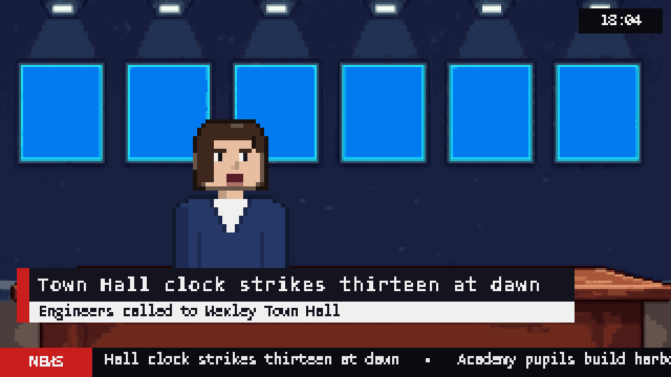 | 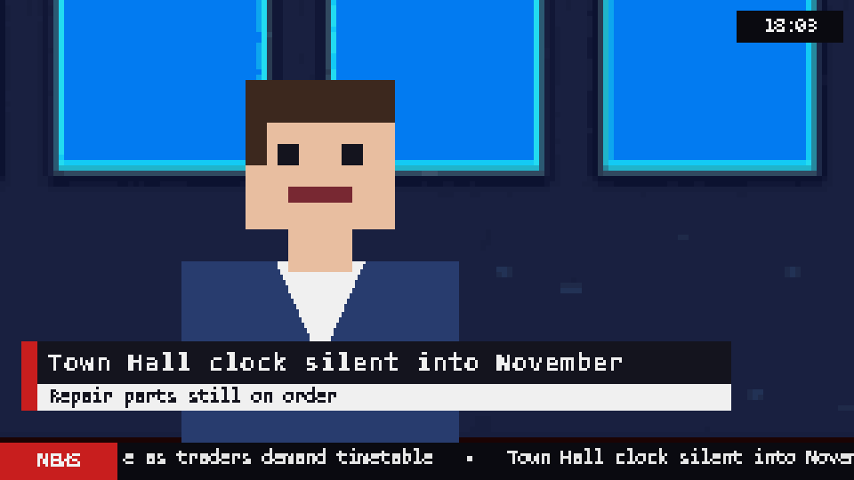 |
| Dana Ferris reads the bulletin | …and the close-up on the next line |
| 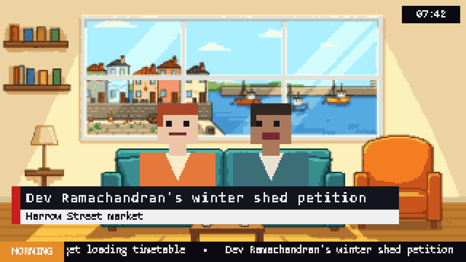 | 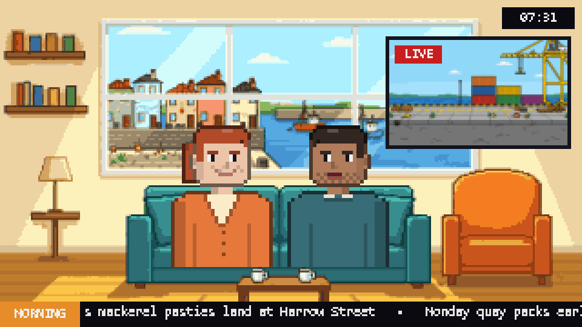 |
| Rosie Treloar and Jonah Pike on the *Morning Tide* sofa | Handing over to Miles at the loading dock |
| 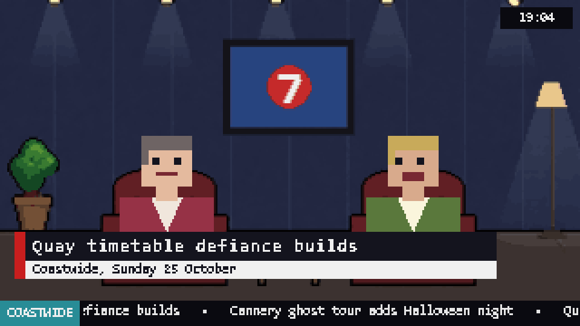 | 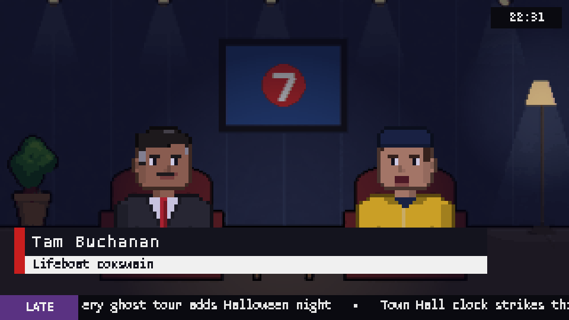 |
| Pat Holloway and Clive Ashdown on *Coastwide* | Vincent Marr and his guest on *The Last Ferry* |
| 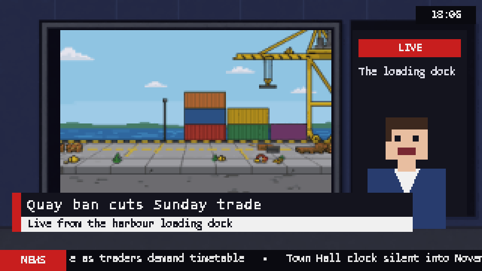 | 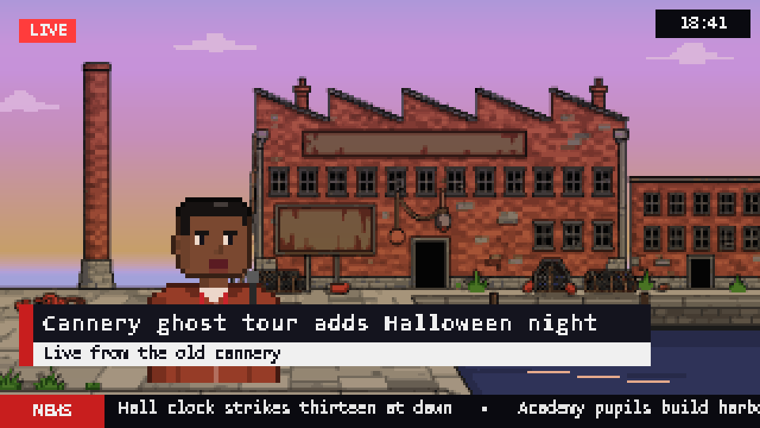 |
| Handing over to a live report at the loading dock | Miles Okafor live from the old cannery at dusk |
| 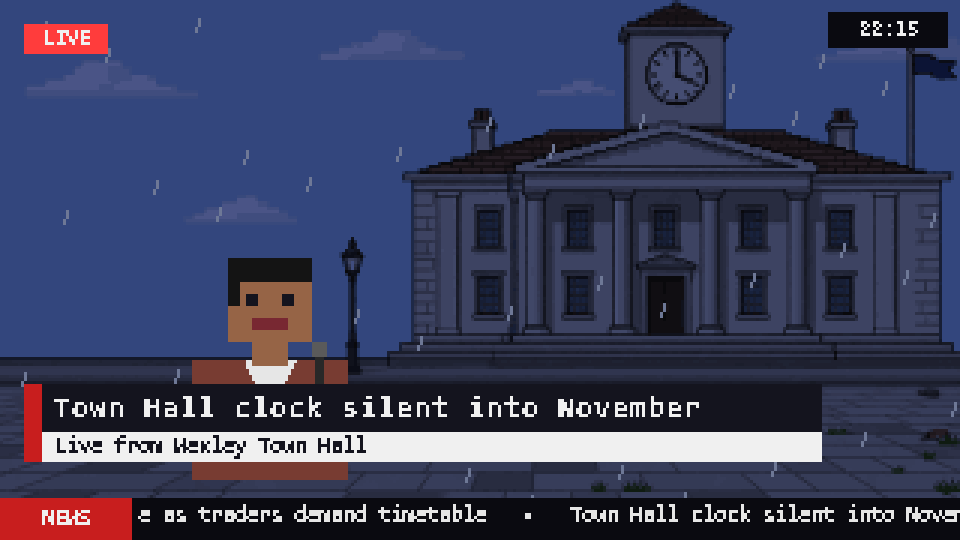 | 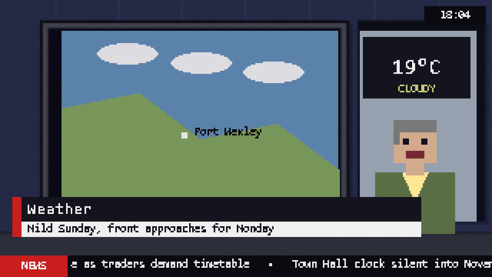 |
| Town Hall at night, graded for the last weather report | Gordon Pell and the weather map |
| 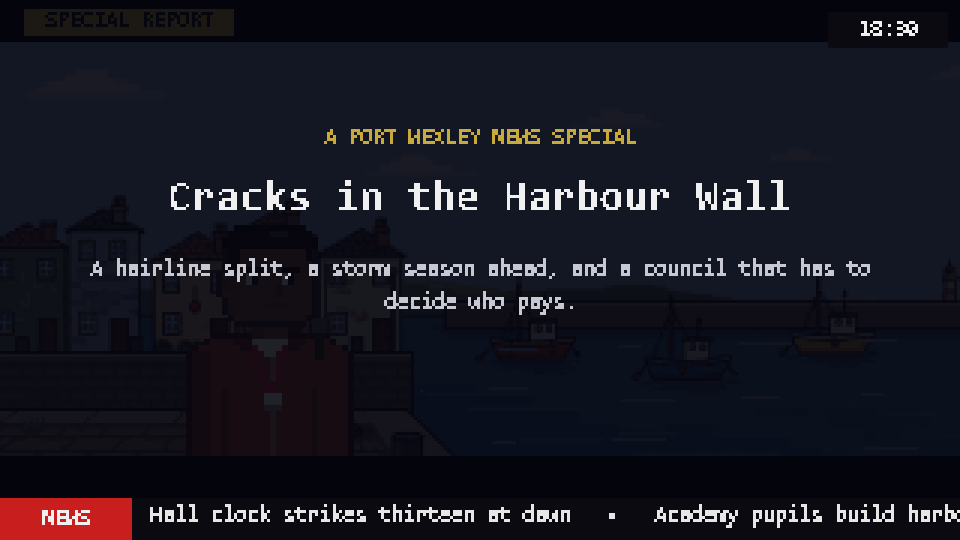 | 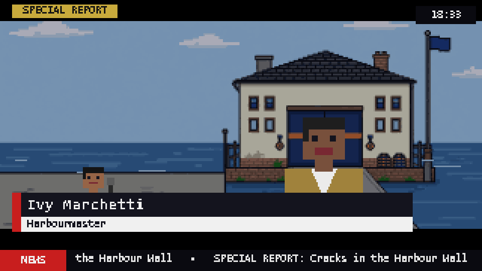 |
| A special report opens | The harbourmaster, interviewed at the lifeboat station |

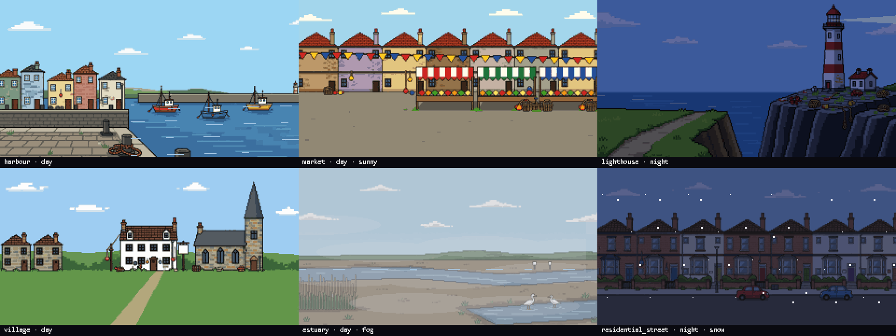
*Six of the 26 locations, at the time of day and in the weather the broadcast is having.*

## How it works

The one rule the whole design hangs on: **the broadcast never waits on the AI.**

```
 producer ──plans slots ahead──▶ priority queue ──▶ worker thread ──▶ buffer ──▶ player (wall clock)
                                      ▲                 │                            │
                                      │        LLM script + Kokoro voice             ▼
                              story desk / editor                     adverts, then filler, when dry
                              local adverts (idle time only)
```

- **Producer** keeps about ten minutes of unplayed content planned, working out
  when each slot will start from what is really queued. The schedule
  (`schedule.py`) decides which show each slot belongs to. The news loops a
  short pattern; breakfast does too, but hands every sofa chat and report a
  different angle; *Coastwide* and *The Last Ferry* run a written-out hour
  with a brief per item. The shows with an order sign off just before the
  next one starts.
- **Worker** scripts each slot with the LLM (strict JSON, validated with
  pydantic, one retry, canned template as a last resort), voices every line
  with Kokoro, and stores a mouth envelope for lip-sync.
- **Player** consumes finished segments on the clock, never cutting audio
  mid-sentence. When nothing is ready it airs local adverts (up to three in a
  row), then filler and, after a while, a replay of the last weather. Breaking
  news cuts in at the next sentence and the programme resumes afterwards.
- **Adverts** for the town's shops and services (`adverts.py`, kept in
  `data/ads/`) are voiced in advance, so they are there when the model is
  slow. Eight hand-written ones are voiced on the first idle moments; the
  model writes another every half hour in idle time, up to forty. An owner
  who speaks in their advert joins the town's cast.
- **Tip-line**: anyone can add a line to `data/tipline.txt`. Plain tips go to
  the next bulletins; a line starting `BREAKING:` interrupts whatever is on,
  with a sting and Dana at the news desk.
- **Story desk** and **editor** run only when the worker is idle and the live
  buffer is healthy. The desk gives each thread a phase and a planned next
  development; the editor occasionally commissions a special, which is written
  in resumable stages that interleave with live work.
- **Scenes** are drawn on a 320×180 canvas and scaled up with nearest
  neighbour, which is where the pixel look comes from. Writers choose from 24
  locations (Port Wexley and its countryside) and the studio has its own sets.
  Each is hand-checked pixel art (`assets/backdrops/`, made with ComfyUI),
  graded in code for the time of day (a sunset tint at dusk; hand-made night
  pictures for the harbour, high street and Town Hall) and for the last
  weather report, with rain, snow, fog and water animated on top. Bulletins cut between a wide shot
  and a close-up, and the anchor hands over to reports from a big-picture
  wall. The people are drawn in code: the presenters to agreed descriptions,
  and every guest with a look of their own from their name, voice and role.

Model routing is config-driven. Any OpenAI-compatible endpoint works (LM
Studio and llama.cpp locally, Moonshot's Kimi in the cloud), plus the Anthropic
SDK. The shipped config uses Claude Haiku 5.5 for live segments and Claude
Sonnet 5.5 for the editor, the story desk and specials; Kimi k2.6 and k3 did
those jobs before and are still declared.

## Status

Early and working. The longest runs so far are hour-long runs with real Kimi
scripts across *Coastwide* and *The Last Ferry*, with no failed segments,
almost no filler, and each show signing off within seconds of the hour; it has
not yet been left on overnight. Things that exist: a daily schedule with
breakfast, the news, a magazine and a talk show; studio interviews, filmed
features, vox pops and specials; breaking news from a viewer tip-line; the
story bible and desk; provider switching, caching, failure recovery, and
backdrop art for every location; code-drawn presenters, and a look of their
own for every guest from their name, voice and role; tides and a foot ferry
worked out by arithmetic; local adverts that cover the gaps. Things that
don't yet: ad breaks inside the shows, and the 30-minute documentary that
specials are the template for.

## A normal day

Unless breaking news cuts in, the station runs this schedule:

| from | show | what's on |
|---|---|---|
| 00:00 | overnight | the test card and repeats of the day's segments (not breakfast's); no live model calls, but the story desk and editor keep working, and a special made overnight airs after the test card |
| 06:00 | *Morning Tide* | breakfast on the sofa with Rosie Treloar and Jonah Pike: the headlines, sofa chats (the papers, a viewer's question, on this day in town history…), Gordon's weather, Miles's reports, and a goodbye before the news |
| 09:00 | the news | Dana Ferris, Gordon and Miles: weather, bulletins, field reports, a studio interview every third loop, and specials |
| 19:00 | *Coastwide* | the early-evening magazine in the spirit of *Nationwide*, with Pat Holloway and Clive Ashdown: an hour of links and banter, filmed features from Miles, studio guests, vox pops, the consumer slot and Gordon's weather, each item with its own angle |
| 20:00 | the news | |
| 22:00 | *The Last Ferry* | Vincent Marr's late-night talk show on the interview set with the lights down: a monologue, then guests who stay for two parts, late-night vox pops and a goodnight |
| 23:00 | the news | the late news |

Breakfast, the magazine and the talk show are **lighter** than the news: warm,
everyday local stories and what's on. The exception is one big running story
(a story that broke as breaking news today, or else the most-covered thread at
its peak): the headlines lead with it briefly, and in the magazine and the
talk show only the opening item does, so it isn't in every item of the hour.

**Breaking news** can cut into any of them. A line starting `BREAKING:` in the
tip-line interrupts at the next sentence: a sting, Dana at the news desk
(Miles may phone in), then back to the programme where it left off. For two
hours afterwards the bulletins lead with it.

**Studio guests** are public figures, residents we have met, or new residents
the writer invents, who then join the recurring cast with a stable voice and
look. A guest who was just on is not rebooked. A presenter can be a guest too
(Gordon Pell, who runs the cannery ghost tours on the side), and appears as
himself. `uv run python -m newsroom.schedule` prints the table, and `--clock
HH:MM` starts the broadcast clock at any time of day to try a show.

## Run it

Needs Python 3.12 (Kokoro doesn't install on 3.13), [uv](https://docs.astral.sh/uv/),
and either a local OpenAI-compatible server or an API key.

```bash
uv sync
uv run python -m newsroom
```

Scripts come from whichever provider `[llm.routes]` in `config.toml` names.
Providers are declared under `[llm.providers.<name>]`. Shipped entries:
`claude_haiku` and `claude_sonnet` (the routes as shipped; need
`ANTHROPIC_API_KEY` in the environment), `moonshot` (Kimi, needs
`MOONSHOT_API_KEY`), `moonshot_k3`, `lmstudio` (local, `http://localhost:1234`)
and `anthropic`. Set
`NEWSROOM_LLM=<name>` to force one provider for every task, or
`NEWSROOM_LLM=off` to run entirely on canned template scripts with no model
at all, which is handy for working on the visuals.

Flags: `--debug` draws slot/buffer status, `--minutes N` auto-exits,
`--no-window` runs the producer, workers and a simulated player headless,
`--snap DIR` saves a frame every 10 s, `--special-now` has the editor consider
a special immediately, `--clock HH:MM` pretends the local time is HH:MM,
`--log-llm` writes every model prompt and reply, with token counts, to
`data/llm_calls/<date>.jsonl` (or set `log_calls = true` under `[llm]`).
Token counts are always on each call's log line, and running totals per
provider are logged every ten minutes and at exit (`LLM USAGE`).

Test runs write to the real town unless told otherwise: every run updates
`data/world.json` and adds to `data/cache/`, whose last two days feed the
overnight repeats. `--world PATH` and `--cache DIR` point a run elsewhere, and
`--scratch` copies the world and the tip-line to a fresh temp dir and runs on
the copy with an empty cache (the path is logged; delete it when done;
`--log-llm` still writes to `data/llm_calls/`). The
same overrides work as environment variables, `NEWSROOM_WORLD`,
`NEWSROOM_CACHE` and `NEWSROOM_TIPLINE`, and those also cover the module CLIs
(`newsroom.world`, `newsroom.workers`, `newsroom.desk`, ...). Every run logs
the world and cache it is using. For a template smoke test:
`NEWSROOM_LLM=off uv run python -m newsroom --no-window --minutes 2 --scratch`.

Expected cold start: filler card → bumper → an advert or a short filler while Kokoro loads →
weather → bulletin → field report → bumper → … After the first loop the buffer
stays ahead and there is no more filler.

## The story bible

`data/world.json` is the town's memory and cast list. It is not in git and
nothing backs it up, so test runs should use `--scratch` (above):

- **Presenters**: Dana Ferris (anchor), Gordon Pell (weather), Miles Okafor
  (field reporter); Rosie Treloar and Jonah Pike (breakfast); Pat Holloway and
  Clive Ashdown (*Coastwide*); Vincent Marr (*The Last Ferry*), with fixed
  voices. Each show's prompt and JSON schema allow only its own cast.
- **People**: seeded public figures and worthies (the mayor, police and fire
  chiefs, the MP, the harbourmaster, a head teacher, the lifeboat coxswain,
  the historical society chair) plus residents promoted from special-report
  guests. Each has a stable voice, speaking speed and look so they can recur.
  Appearances are counted whenever a script names them.
- **Threads**: story lines with a phase (emerging → developing → peak →
  resolving → closed), the beats aired so far, the people involved and a
  planned NEXT development. Writers see the NEXT in their briefing and are told
  a follow-up must deliver it, so stories move instead of repeating.
  The board keeps 40 threads: a new one drops the quietest closed thread,
  never an open one (with all 40 open it grows and logs a warning). Template
  scripts (`NEWSROOM_LLM=off` or a failed model call) never open threads,
  except breaking news, whose tip is real.
- **Archive**: every segment aired, searchable, for callbacks now and for
  documentary research later.

The **story desk** (`desk.py`) runs every `plan_every_s` when the worker is
idle and the live buffer is healthy. It assigns phases, writes next
developments, closes finished threads and occasionally seeds a new one. Each
call plans a batch of threads (`[story] batch`, the least recently planned
first), so the reply stays small as the town grows and the board rotates.

```bash
uv run python -m newsroom.desk plan --dry      # see what the desk would do
uv run python -m newsroom.desk plan            # apply it
uv run python -m newsroom.world editor         # the fuller briefing the desk sees
uv run python -m newsroom.world archive        # last 20 archive entries
```

## Special reports

The first step towards documentaries. The editor reads the open threads every
`check_every_s` and decides whether one has earned a five-minute piece;
usually the answer is no. A commissioned special is a **resumable**
low-priority job: outline, then one section per stage, then voicing, then
finish. After each stage it re-queues itself, so live slots are served in
between and the longest uninterruptible unit is one model call. Progress is
checkpointed to `data/cache/*.partial.json` and resumed on startup; a stage that
fails (a model timeout) is tried once more before the special is dropped. A finished
special waits for the next news bumper (overnight, the next test card), and survives
a restart until it has aired. Knobs live under `[special]` and `[story]`
in `config.toml`.

```bash
uv run python -m newsroom.special decide                       # ask the editor now
uv run python -m newsroom.special make --thread t002           # write one for a thread
```

## Layout

| file | job |
|---|---|
| `config.toml` / `config.py` | providers, routes, voices, buffer horizon, paths |
| `models.py` | `Segment`, `Line`, `VisualCue`, and the per-type LLM schemas |
| `world.py` | the story bible: presenters, people, threads, archive |
| `llm.py` | one `complete_json()` door; OpenAI-compatible or Anthropic; strict JSON + one retry |
| `writers.py` | prompts per show and segment type, studio guests, template fallbacks |
| `special.py` | the editor decision and the resumable special-report stages |
| `desk.py` | the story desk: phases, next developments, new threads |
| `tipline.py` | the viewer tip-line file: new lines, pending tips, the CLI |
| `breaking.py` | breaking news: sorting tip-line lines, scripting and stinging the interrupt |
| `tts.py` | Kokoro on CPU → 24 kHz WAV + mouth envelope |
| `assets.py` | bakes the placeholder bumpers, breaking sting and music bed on first run |
| `buffer.py` | priority intake queue + ready-by-slot dictionary + pockets for specials and breaking news |
| `schedule.py` | the shows, the daily schedule and the broadcast clock |
| `producer.py` | plans slots ahead from the schedule and the show's running order; closings and hand-overs |
| `workers.py` | generation thread, content cache, watchdog, idle editorial work |
| `player.py` | consumes the buffer, drives audio, applies timed cues, builds the `View` |
| `locations.py` | the places a picture can be set, and where people stand on the studio sets |
| `backdrops.py` | backdrop art or placeholder, time-of-day and weather grading, animated touches |
| `scenes.py` / `sprites.py` | draws the `View` on a 320×180 canvas scaled up |

## Dev commands

```bash
uv run python -m newsroom.tts "Good evening"          # synth one line and play it
uv run python -m newsroom.llm weather --dry-run        # show prompt + schema, no call
uv run python -m newsroom.llm sofa --show breakfast --dry-run   # a breakfast prompt
uv run python -m newsroom.llm interview --show late --part cont --dry-run   # a guest's second part
uv run python -m newsroom.schedule                     # the day's schedule
uv run python -m newsroom --clock 06:00 --debug        # watch breakfast at any hour
uv run python -m newsroom.llm weather                  # live call to the routed provider
uv run python -m newsroom.world                        # print the writers' briefing
uv run python -m newsroom.workers field_report         # one segment end to end
uv run python -m newsroom --no-window --minutes 3 --scratch   # headless soak on a copy of the town
uv run pytest                                          # all tests, on a temp town (no model, no TTS)
uv run python -m unittest tests.test_world             # thread cap and template threads (no model, no TTS)
uv run python -m newsroom.backdrops --sheet sheet.png  # every backdrop at day, dusk and night
uv run python -m newsroom.sprites --sheet people.png   # every presenter and a crowd of guests
uv run python -m newsroom.tides 2026-11-02             # that day's tides and foot ferry
uv run python -m newsroom.adverts                      # the advert pool (--make writes and voices one)
uv run python -m newsroom.tipline "BREAKING: Smoke over the old cannery"   # breaking news
uv run python -m newsroom.tipline "The lifeboat open day is on Saturday"   # a tip for the bulletins
```

Generated audio and segment JSON live in `data/cache/`, keyed by (type, date,
slot, town, day, provider, show, and the running order's part and brief). Delete the folder to force regeneration.
Overnight repeats are drawn from the last two days of this cache.

## Notes

- Python is pinned to 3.12 because `kokoro`/`misaki` do not install on 3.13.
- Kokoro runs on CPU on purpose so the GPU is free for a local model.
- Kimi k2.6 is a thinking model: with thinking disabled it only accepts
  temperature 0.6; with it enabled, only 1.0 and it needs ~4000 `max_tokens`
  to leave room for reasoning. The shipped config disables thinking for live
  segments and enables it for the editor, desk and specials on k3.
- `<think>` blocks are stripped defensively regardless of provider.
- Generated content is cached per provider, so switching providers never
  replays another provider's scripts.
- More than one worker is not supported yet: the world state has no lock.
